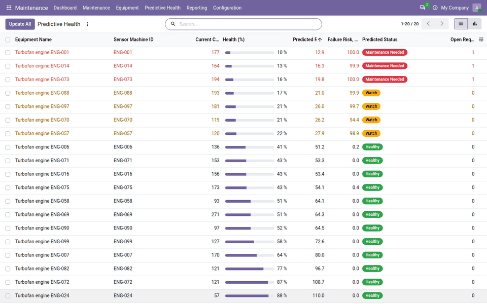
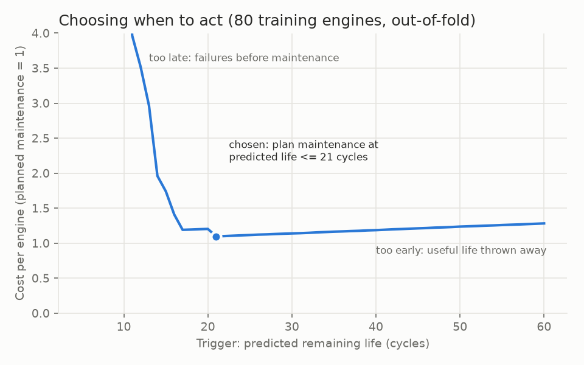
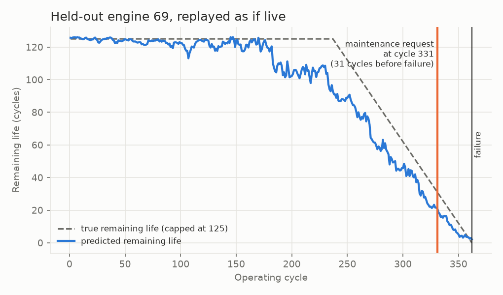
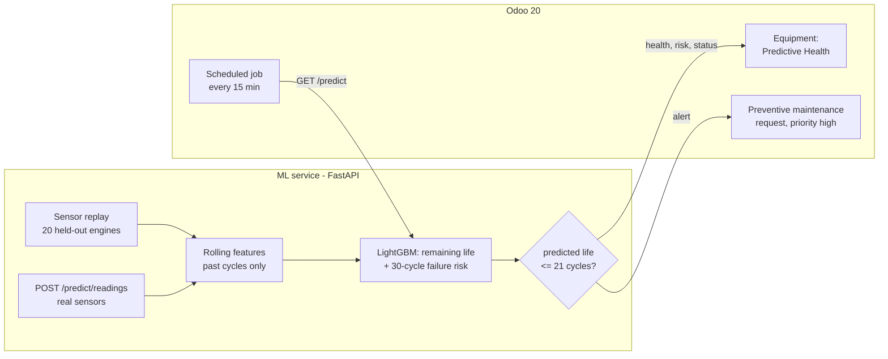
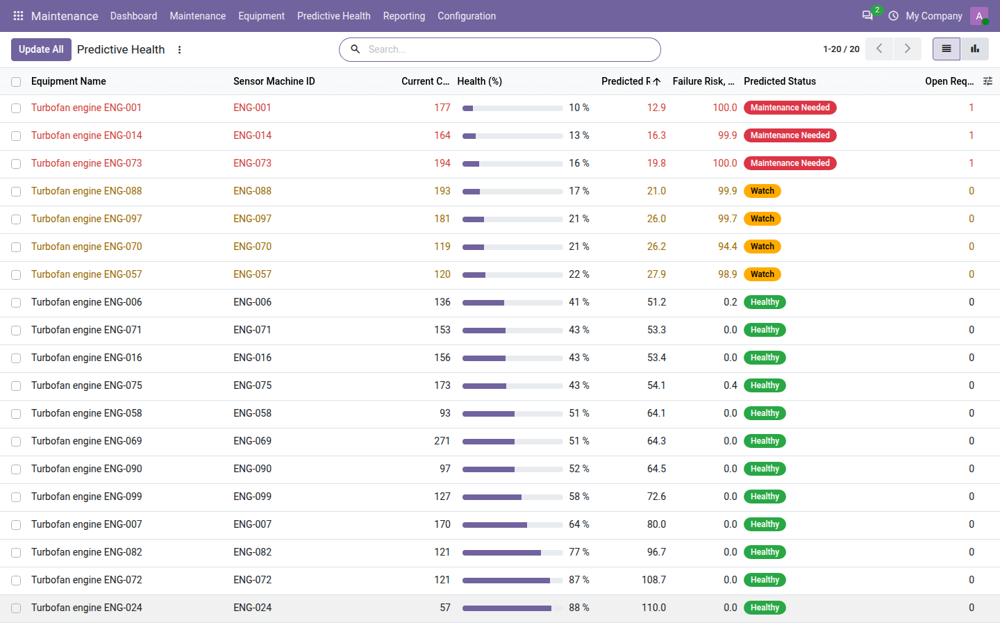
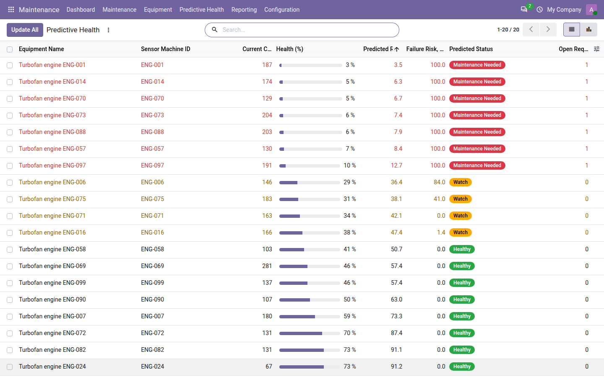
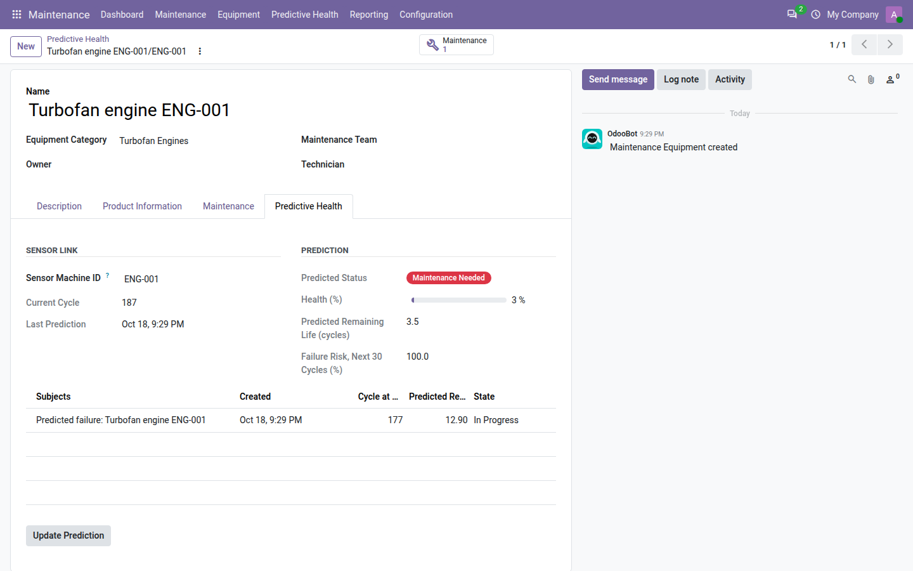
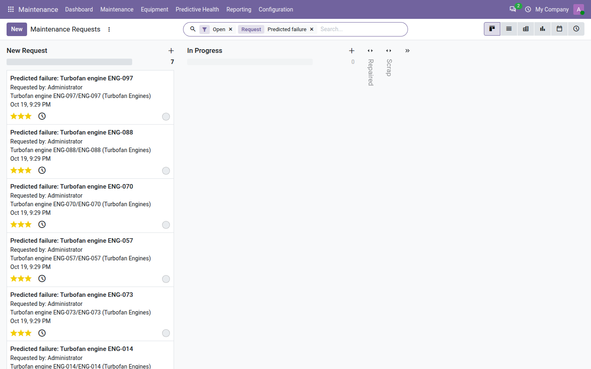

# Predictive Maintenance for Odoo 20

The project predicts engine failures from sensor data and turns the prediction into a **preventive maintenance
request in Odoo 20 before the failure happens**:
1. A LightGBM model reads rolling sensor features and estimates each machine's remaining life and its risk of
   failing in the next 30 cycles.
2. A cost-based rule decides when to act.
3. An Odoo module shows equipment health and opens the maintenance request automatically.

A sensor replay feeds the service with engines the model has never seen, cycle by cycle, as if they were live.



## Results

Data: NASA's turbofan engine degradation data, subset FD001. That is 100 engines run until failure, plus 100 test
engines with known remaining life (see [Data](#data)). No engine is ever split across groups.

### Remaining life (NASA's test set, last cycle of each of the 100 engines)

| Method | RMSE (cycles) | MAE (cycles) |
|---|---|---|
| Average fleet life minus current cycle | 36.7 | — |
| **LightGBM on rolling sensor features** | **13.1** | **9.6** |

An RMSE of 13.1 is in the range usually reported for FD001 with this kind of model. The training target is capped
at 125 cycles, as is common; the error is measured against the true, uncapped remaining life.

### "Will it fail in the next 30 cycles?" (NASA's test set, every cycle: 13,096 cycles, 100 engines)

| Method | ROC-AUC | PR-AUC |
|---|---|---|
| Average fleet life | 0.713 | 0.140 |
| Best single sensor drift, threshold tuned on the training engines | 0.915 | 0.500 |
| **LightGBM** | **0.998** | **0.946** |

### When to act: maintenance policy on 20 held-out engines

These 20 engines were never used for training or tuning, and all run until failure. The rule was chosen on the
other 80 engines (out-of-fold, by engine): **plan maintenance when the predicted remaining life is 21 cycles or
fewer.**

| Policy | Cost per engine | Missed failures | Median notice before failure |
|---|---|---|---|
| Reactive (run to failure) | 10.00 | 20 of 20 | — |
| Fixed interval (every 118 cycles, best on training engines) | 1.37 | 0 | 79 cycles |
| Single sensor drift threshold | 1.16 | 0 | 31 cycles |
| **Model: predicted life ≤ 21 cycles** | **1.10** | **0** | **20 cycles** (minimum 15) |

**Cost assumptions** (relative units; change them in `train.py`):
- A planned maintenance costs 1.
- An unplanned failure costs 10 (repair plus downtime).
- Maintaining early wastes the remaining life, valued at 1 per full average life.
- Maintenance needs at least **10 cycles of notice** to be scheduled, so a later warning counts as a failure.

Under these assumptions:
- The model costs **89% less than running to failure** and 20% less than the best fixed schedule.
- It costs only **5% less than a simple sensor-drift rule**.

Most of the value comes from monitoring at all. The model's own edge is that it acts later without missing
failures, so less useful life is thrown away.





### Cross-check: UCI AI4I 2020 (10,000 machining processes, 3.4% failures)

| Method | ROC-AUC | PR-AUC |
|---|---|---|
| The dataset's own documented failure rules | 0.923 | 0.852 (precision 100%, recall 85%) |
| LightGBM, raw sensors | 0.978 | 0.830 |
| LightGBM, plus power, temperature difference, wear × torque | 0.980 | 0.882 |

AI4I is synthetic, and its documentation states the rules that generate failures. The model learns those rules
from data alone. The 15% of failures the rules miss are tool-wear and random failures, which are random by design.
The failure-mode columns are never used as features, because they define the label.

## How it works



**Features** ([features.py](ml/src/pdm_ml/features.py)), for each of the 15 sensors that vary:
- the current value
- rolling mean and standard deviation over 5, 10 and 20 cycles
- the trend (slope) over 20 cycles
- the drift from the engine's own starting level

Every feature uses only the current and earlier cycles. A test checks that features computed from a partial
history equal those from the full history, so the live replay produces exactly the offline predictions.

**Two models:**
- **Remaining life:** a regression model; it drives the alert rule.
- **Risk of failure in the next 30 cycles:** a classifier; it is shown as a risk percentage.

The rule uses remaining life, not the classifier's probability. Close to failure that probability saturates near
1, which makes a probability threshold a poor control, and planners think in "cycles left".

## Inside Odoo

Module `addons/maintenance_predict` (Odoo 20 Community, depends on `maintenance`).

**Equipment:**
- a *Predictive Health* tab with the sensor machine ID, the current cycle, the health % (predicted life ÷ 125), the
  predicted remaining life, the 30-cycle failure risk, and the status: Healthy / Watch (≤ 50 cycles) / Maintenance
  Needed / Failed
- a status badge on the kanban cards

**Maintenance → Predictive Health:**
- all linked equipment, sorted by predicted remaining life
- an *Update All* button, and a pie chart by status

**Automatic requests:**
- When the service raises an alert, one **preventive** request is created: priority high, marked *Created by
  Prediction*, with the cycle and predicted life at creation.
- No second request is opened while one is still open.
- No request is opened for a machine that has already failed.

**Reliability:** a scheduled action runs every 15 minutes. If the service is down, the job logs a warning and
continues; the buttons show a clear error.

**Settings:** the service URL, plus demo buttons to advance or restart the sensor replay.

| Fleet health: Healthy, Watch and Maintenance Needed | 10 cycles later: more machines need maintenance |
|---|---|
|  |  |
| **Equipment: Predictive Health tab** | **Preventive requests created by the prediction** |
|  |  |

The screenshots are taken automatically from the Docker demo: `make reset-demo && make screenshots`.

**End-to-end check** (`scripts/e2e_check.py`, locally and in Docker):
1. 20 equipment are linked to the 20 held-out engines.
2. The replay starts 60 cycles before each failure and advances one cycle at a time, with Odoo updating after
   each cycle.

Results:
- **All 20 engines got their maintenance request before failing**, with at least 15 cycles of notice (median 20).
- Every request was created at exactly the cycle the offline evaluation predicted (20 of 20).

## Run it

```bash
make demo   # builds: downloads + verifies both datasets, trains (about 30 s); creates database "demo";
            # links 20 equipment; replays the engines to failure through Odoo; prints the check
```
- Odoo: http://localhost:8072 (admin / admin) → *Maintenance → Predictive Health*
- Service: http://localhost:8003/docs
- MLflow: http://localhost:5003

The ports differ from the other portfolio projects.

Without Docker:
```bash
cd ml && ./download_data.sh data/raw            # official sources, SHA-256 verified
python -m venv .venv && . .venv/bin/activate && pip install -e ".[dev,mlflow]"
python -m pdm_ml.train && python -m pdm_ml.charts models/latest ../docs && python -m pdm_ml.ai4i
uvicorn pdm_ml.service:app --port 8003
```

Tests:
- `pytest` in `ml/` runs 7 tests: labels, no look-ahead in features, the cost model, models beating the
  baselines, replay equal to offline, the raw-readings endpoint, and AI4I.
- The Odoo module tests: `odoo-bin -i maintenance_predict --test-tags /maintenance_predict`.

## Data

- **NASA C-MAPSS, FD001.** A. Saxena and K. Goebel (2008), "Turbofan Engine Degradation Simulation Data Set",
  NASA Prognostics Data Repository, NASA Ames Research Center, Moffett Field, CA.
  - Downloaded from the repository's official link.
  - The repository names no license. It states that users employ the data at their own risk, and that
    publications should credit the repository and the data donors.
  - The data is **not** included in this repository; `download_data.sh` fetches it.
- **UCI AI4I 2020 Predictive Maintenance Dataset** (2020), UCI Machine Learning Repository,
  https://doi.org/10.24432/C5HS5C. License: CC BY 4.0.

## Limitations

- **Simulated engines, not factory equipment.** C-MAPSS comes from an engine simulation with one operating
  condition and one fault mode (FD001); AI4I is synthetic. Real machines have maintenance history, sensor faults,
  several failure modes and changing operating conditions.
- **The cost figures follow from the stated assumptions.** With different failure and maintenance costs or a
  different lead time, the chosen rule and the savings change. Re-run `train.py` with your own numbers.
- **The policy test uses 20 held-out engines.** That is enough to compare policies, not to give a tight error bar.
- **Only FD001 was used.** FD002–FD004, with six operating conditions and two fault modes, are harder and are not
  covered.
- **The sensor replay is a demo.** Real deployments would send readings to `/predict/readings` (or store them in
  Odoo), and machines would need a model trained on their own run-to-failure history.

## License

LGPL-3.0. See [LICENSE](LICENSE).
